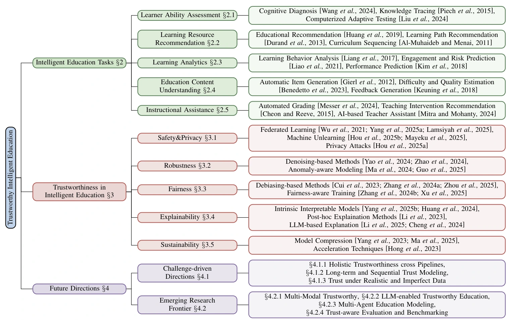
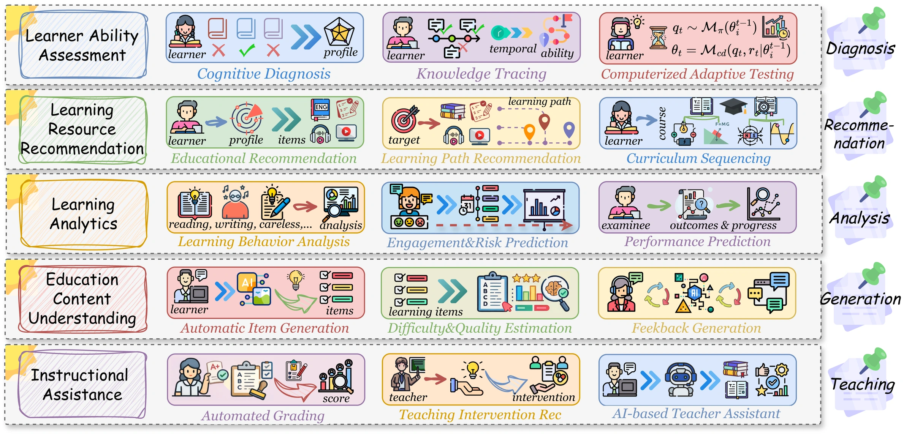
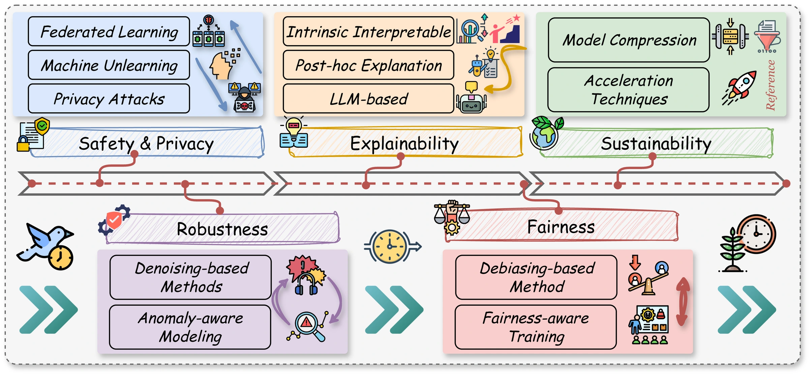

# Trustworthy Intelligent Education
# 可信智能教育：研究进展、挑战与未来方向

**Trustworthy Intelligent Education: A Systematic Perspective on Progress, Challenges, and Future Directions**

**Authors / 作者：** Xiaoshan Yu, Shangshang Yang, Ziwen Wang, Haiping Ma, Xingyi Zhang  
**Affiliation / 单位：** Anhui University（安徽大学）

[📄 Paper / 论文](https://arxiv.org/pdf/2601.21837) · [📖 Online Reading / 在线阅读](https://arxiv.org/html/2601.21837v1) · [📚 arXiv](https://arxiv.org/abs/2601.21837)

## 📌 Overview / 论文概述

智能教育系统正广泛参与学习者能力评估、学习资源推荐与教学支持。由于教育场景涉及未成年人和弱势群体、细粒度的个人学习数据，以及对学习者发展具有长期影响的决策，系统的可信性成为不可忽视的研究问题。

本综述围绕 **“教育系统做什么”与“如何让系统值得信任”** 两个层面，构建“**五类教育任务 × 五个可信维度**”的组织框架，系统梳理已有研究的方法与策略，并总结其局限和未来研究方向。

Intelligent education increasingly shapes assessment, recommendation, and instructional support. Sensitive learner data and consequential educational decisions make trustworthiness a central concern. This survey connects **five educational task categories** with **five trustworthiness perspectives**, organizing existing methods, identifying limitations, and outlining future directions.



*Figure 1. The taxonomy of trustworthy intelligent education. / 图1：可信智能教育的整体分类框架。*

## 💡 Motivation & Contributions / 动机与贡献

现有研究往往围绕某个任务中的单一可信问题展开，而相关综述的讨论又容易停留在宏观层面，缺乏清晰、统一的分类。本文旨在连接分散的研究，提供便于理解和定位相关工作的结构化视角。

Existing work is often fragmented across individual tasks or trust concerns. The survey provides a structured perspective through four contributions:

- **Task landscape / 任务梳理：** 按教育功能组织五类代表性任务，明确可信研究所服务的任务背景。
- **Trustworthiness taxonomy / 可信分类：** 从五个互补维度归纳已有方法与解决策略。
- **Critical discussion / 挑战分析：** 总结不同可信维度在真实教育场景中的局限与开放问题。
- **Research agenda / 未来方向：** 从现实挑战和新兴技术两个角度讨论后续研究机会。

## 🎓 Educational Task Landscape / 教育任务版图

| Task category / 任务类别 | Representative scope / 代表性内容 |
| --- | --- |
| **Learner Ability Assessment / 学习者能力评估** | Cognitive Diagnosis、Knowledge Tracing、Computerized Adaptive Testing；认知诊断、知识追踪与计算机化自适应测试。 |
| **Learning Resource Recommendation / 学习资源推荐** | Educational recommendation、learning path recommendation、curriculum sequencing；教育资源推荐、学习路径推荐与课程排序。 |
| **Learning Analytics / 学习分析** | Learning behavior analysis、engagement and risk prediction、performance prediction；学习行为分析、参与度与风险预测、表现预测。 |
| **Educational Content Understanding / 教育内容理解** | Item generation、difficulty and quality estimation、feedback generation；试题生成、难度与质量评估、反馈生成。 |
| **Instructional Assistance / 教学辅助** | Automated grading、intervention recommendation、AI-based teaching assistance；自动评分、教学干预推荐与 AI 教学辅助。 |



*Figure 2. Five representative task categories. / 图2：五类代表性智能教育任务。*

## 🛡️ Trustworthiness Perspectives / 五个可信维度

| Perspective / 可信维度 | Research focus / 关注问题 | Method families / 方法类别 |
| --- | --- | --- |
| **Safety & Privacy / 安全与隐私** | 如何保护敏感学习数据，并识别潜在泄露风险？ / Protect sensitive learning data and examine leakage risks. | Federated Learning、Machine Unlearning、Privacy Attacks；联邦学习、机器遗忘与隐私攻击研究。 |
| **Robustness / 鲁棒性** | 如何在噪声记录、异常行为等条件下维持可靠建模？ / Maintain reliability under noisy records and atypical behavior. | Denoising-based Methods、Anomaly-aware Modeling；去噪方法与异常感知建模。 |
| **Fairness / 公平性** | 如何识别和缓解学习者建模与教育决策中的偏差？ / Identify and mitigate bias in learner modeling and educational decisions. | Debiasing-based Methods、Fairness-aware Training；去偏方法与公平感知训练。 |
| **Explainability / 可解释性** | 如何为学生、教师和管理者提供可理解的决策依据？ / Make educational decisions understandable to stakeholders. | Intrinsically Interpretable Models、Post-hoc Explanations、LLM-based Explanations；内在可解释模型、事后解释与大模型辅助解释。 |
| **Sustainability / 可持续性** | 如何兼顾计算效率、可扩展性及长期维护？ / Support efficient, scalable, and maintainable deployment. | Model Compression、Acceleration Techniques；模型压缩与加速技术。 |



*Figure 3. Research categories across trustworthiness perspectives. / 图3：不同可信维度下的研究类别。*

## 🔍 Open Challenges / 关键挑战

- **Across the pipeline / 跨流程可信性：** 现有方法多聚焦孤立任务，难以保障从数据采集、学习者建模到推荐与教学决策的整体可信性。Existing methods often address isolated tasks rather than interconnected educational processes.
- **Over time / 长期可信性：** 学习者状态和教育决策的影响会随时间积累，单步或短期评估难以充分刻画长期公平性与可靠性。Trust must account for evolving learners and cumulative decision effects.
- **Under realistic data / 真实数据条件：** 噪声、缺失、异常行为与分布变化，使理想化假设下的方法难以直接适应真实平台。Realistic educational data challenge assumptions about noise and learner behavior.
- **Across objectives / 多目标权衡：** 隐私、鲁棒性、公平性、可解释性与效率之间可能存在权衡，需要结合教育目标进行系统考虑。Trust-related objectives must be considered alongside predictive performance and practical constraints.

## 🚀 Future Directions / 未来研究方向

本文从现实挑战与新兴研究前沿两个层面提出研究议程。

The research agenda connects practical challenges with emerging capabilities:

1. **Holistic Trustworthiness / 全流程可信保障：** 探索贯穿学习数据、认知建模、推荐、决策与教学支持的可信框架。
2. **Long-term and Sequential Trust Modeling / 长期与序列可信建模：** 研究可信属性随学习过程和决策序列的变化。
3. **Trust under Imperfect Data / 不完美数据下的可信学习：** 显式考虑噪声、缺失和分布偏移。
4. **Multimodal Trustworthy Education / 多模态可信教育：** 联合处理文本、图像、语音、视频与行为记录中的可信问题。
5. **LLM-enabled Trustworthy Education / 大模型赋能的可信教育：** 关注幻觉、偏差、推理稳定性及教育目标对齐。
6. **Multi-agent Educational Modeling / 多智能体教育建模：** 探索学生、教师等角色模拟的可靠性及基于模拟的策略风险。
7. **Trust-aware Evaluation and Benchmarking / 可信感知评估与基准：** 在准确率之外，系统衡量安全、鲁棒、公平、解释与可持续性。

## 📝 Citation / 引用

如果本综述对你的研究有所帮助，欢迎引用：  
If you find this survey useful, please consider citing:

```bibtex
@article{yu2026trustworthy,
  title = {Trustworthy Intelligent Education: A Systematic Perspective on Progress, Challenges, and Future Directions},
  author = {Yu, Xiaoshan and Yang, Shangshang and Wang, Ziwen and Ma, Haiping and Zhang, Xingyi},
  year = {2026},
  eprint = {2601.21837},
  archivePrefix = {arXiv},
  primaryClass = {cs.CY},
  url = {https://arxiv.org/abs/2601.21837}
}
```

---

本仓库提供论文展示网站的静态页面与相关图表。以上图表来自论文。  
This repository contains the static project website and figures accompanying the survey. Figures are reproduced from the paper.
